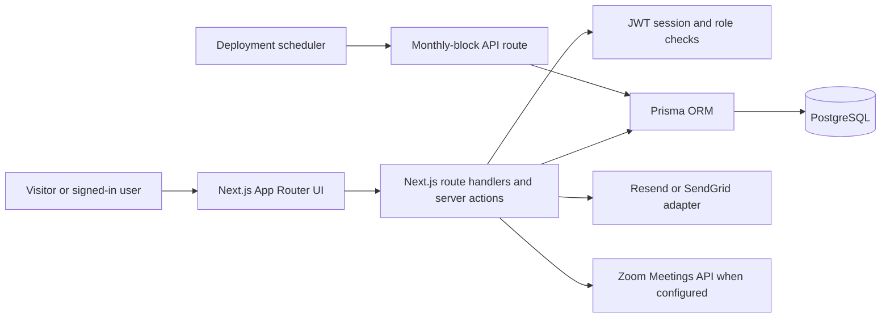

<div align="center">


# Online Islamic Academy

An online academy website and learning operations app built with Next.js. It brings course discovery, trial booking, family accounts, enrollment review, and teacher administration into one place.

[](https://github.com/Attayab-31/Online-Islamic-Academy/stargazers)
[](https://github.com/Attayab-31/Online-Islamic-Academy)
[](https://github.com/Attayab-31/Online-Islamic-Academy/commits/main)
[](https://nextjs.org/)
[](https://www.typescriptlang.org/)

[Live demo](https://islamic-academy-two.vercel.app/) · [Repository](https://github.com/Attayab-31/Online-Islamic-Academy) · [Report an issue](https://github.com/Attayab-31/Online-Islamic-Academy/issues)

[Overview](#overview) · [Features](#features) · [Architecture](#system-architecture) · [Quickstart](#quickstart) · [API](#api-reference) · [Security](#security-and-limitations) · [Contact](#contact-and-community)

Share this repository: [](https://twitter.com/intent/tweet?text=Explore%20Online%20Islamic%20Academy&url=https%3A%2F%2Fgithub.com%2FAttayab-31%2FOnline-Islamic-Academy) [](https://www.linkedin.com/sharing/share-offsite/?url=https%3A%2F%2Fgithub.com%2FAttayab-31%2FOnline-Islamic-Academy) [](https://www.facebook.com/sharer/sharer.php?u=https%3A%2F%2Fgithub.com%2FAttayab-31%2FOnline-Islamic-Academy) [](https://www.reddit.com/submit?url=https%3A%2F%2Fgithub.com%2FAttayab-31%2FOnline-Islamic-Academy&title=Online%20Islamic%20Academy) [](https://api.whatsapp.com/send?text=Online%20Islamic%20Academy%20https%3A%2F%2Fgithub.com%2FAttayab-31%2FOnline-Islamic-Academy)

**Support the project:** [⭐ Star Online Islamic Academy](https://github.com/Attayab-31/Online-Islamic-Academy)

</div>

## Overview

Online Islamic Academy is a Next.js App Router project for presenting Quran learning programs and handling parts of a student onboarding workflow. The codebase combines public marketing pages with server routes and role-specific admin, teacher, and family screens.

The live site is provided as a demonstration. Some visible content is sample/static copy from local TypeScript data, not verified operational academy information. See [what is implemented and what is illustrative](#security-and-limitations) before using it as a real service.

## Features

- Public pages for courses, programs, teachers, pricing, FAQs, policies, blog content, and country-specific learning pages.
- Interactive trial booking that stores a booking and a related pending enrollment in PostgreSQL.
- Account signup, login, logout, session cookies, and password reset flows.
- Family enrollment views and admin review actions, with role-checked teacher/admin booking operations.
- Teacher availability read API and scheduled monthly-block processing endpoint.
- Email adapter for Resend or SendGrid, with development-mode email logging.
- Zoom meeting creation adapter and a development demo-link mode.
- Responsive visual design, motion preferences, and a Three.js/Fiber hero scene with a fallback.

## Demo

Visit the [live Vercel demo](https://islamic-academy-two.vercel.app/). It is a running deployment, not a promise of production service availability or that the sample site content represents actual academy operations.

## System architecture



The application server owns request validation, session handling, persistence, and integrations. Prisma connects to PostgreSQL. Supabase can host that PostgreSQL database, but the app's active persistence path is Prisma; the Supabase client helper is not currently used by the route handlers.

## Technology stack

| Area | Technology |
| --- | --- |
| Application | Next.js 15, React 18, TypeScript |
| Styling and UI | Tailwind CSS, Radix UI, Framer Motion, Lucide |
| Database | PostgreSQL, Prisma 6 |
| Authentication | `jose` JWTs, bcryptjs password hashes, HTTP-only cookie sessions |
| Validation | Zod |
| Meeting integration | Zoom API adapter; local demo mode |
| Email integration | Resend or SendGrid; development log mode |
| Tests | Node.js test runner with `tsx` |

## Project structure

| Path | Purpose |
| --- | --- |
| `src/app/` | App Router pages and HTTP route handlers |
| `src/components/` | Shared layout, forms, hero, and UI components |
| `src/data/` | Static course, program, teacher, country, FAQ, blog, and testimonial content |
| `src/lib/` | Auth, Prisma, booking, enrollment, email, meeting, and scheduling logic |
| `prisma/schema.prisma` | PostgreSQL data model |
| `prisma/seed.ts` | Optional environment-configured account seeding |
| `scripts/` | Database migration utility |
| `reset-db-data.sql` | Development-only SQLite cleanup script; it deletes application rows. |
| `vercel.json`, `render.yaml`, `staticwebapp.config.json`, `swa-cli.config.json` | Deployment configuration examples for multiple hosts; review each against the selected hosting mode. |
| `tests/` | Node test runner tests for auth and domain helpers |
| `assets/repository-banner.svg` | Accessible README banner artwork |
| `LICENSE` | GNU Affero General Public License, version 3 (AGPL-3.0) |

## Quickstart

### Prerequisites

- Node.js 20 or newer and npm. The package manifest requires Node `>=20`; the installed Next.js version and current Next.js guidance require Node 20.9 or newer.
- A reachable PostgreSQL database. A Supabase PostgreSQL connection string can be used.

### Install and run

```bash
git clone https://github.com/Attayab-31/Online-Islamic-Academy.git
cd Online-Islamic-Academy
npm ci
```

Copy `.env.example` to `.env` and fill the database value. For a local development instance, you can leave optional email and Zoom credentials unset; email is logged locally and meetings use a demo URL.

```bash
# macOS / Linux
cp .env.example .env

# Windows PowerShell
Copy-Item .env.example .env
```

Generate Prisma Client, apply the current Prisma schema to the configured database, and start Next.js:

```bash
npm run db:generate
npm run db:push
npm run dev
```

Open [http://localhost:3000](http://localhost:3000). For an admin account, set `ADMIN_EMAIL` and `ADMIN_PASSWORD` before running
`npm run db:seed`. Parent accounts can also be created from the signup page. Do not use example passwords outside local development.

### Environment variables

Keep secrets in `.env` or your deployment provider's secret settings. `.env.example` contains placeholders only.

| Variable | Required | Read by | Purpose |
| --- | --- | --- | --- |
| `DATABASE_URL` | Yes* | Prisma | PostgreSQL connection URL; takes precedence over `SUPABASE_DB_URL`. |
| `SUPABASE_DB_URL` | Yes* | Prisma | Fallback PostgreSQL connection URL for a Supabase database. |
| `AUTH_SECRET` | Production | Session signing | Must be at least 32 characters in production. Development has a local fallback. |
| `ADMIN_EMAIL`, `ADMIN_PASSWORD` | Production | Auth bootstrap, Prisma seed | Explicit admin bootstrap credentials; production auth fails without them. |
| `PORTAL_EMAIL`, `PORTAL_PASSWORD` | Optional | Auth bootstrap, Prisma seed | Optional parent bootstrap account. |
| `TEACHER_EMAIL`, `TEACHER_PASSWORD` | Optional | Auth bootstrap, Prisma seed | Optional teacher bootstrap account. |
| `NEXT_PUBLIC_SITE_URL` | Recommended | Metadata and email links | Canonical base URL; use the deployed HTTPS URL in production. |
| `NEXT_PUBLIC_WHATSAPP_NUMBER` | Optional | Mobile contact CTA | WhatsApp number in international digits format, without `+`. |
| `EMAIL_PROVIDER` | Optional | Email adapter | `resend` or `sendgrid`; defaults to a configured key or local logging. |
| `RESEND_API_KEY`, `SENDGRID_API_KEY` | Production email | Email adapter | Credentials for the selected email provider. Configure the sender with `EMAIL_FROM`. |
| `EMAIL_FROM` | Production email | Email adapter | Verified sender address for outgoing mail. |
| `MEETING_PROVIDER` | Production bookings | Meeting adapter | Set to `zoom` in production; local default is `demo`. |
| `ZOOM_ACCOUNT_ID`, `ZOOM_CLIENT_ID`, `ZOOM_CLIENT_SECRET` | Zoom bookings | Meeting adapter | Zoom Server-to-Server OAuth credentials. |
| `CRON_SECRET` | Production cron | Monthly-block endpoint | Shared secret accepted as `x-cron-secret` or `Authorization: Bearer …`. |
| `SUPABASE_URL`, `SUPABASE_ANON_KEY`, `NEXT_PUBLIC_SUPABASE_URL`, `NEXT_PUBLIC_SUPABASE_ANON_KEY`, `SUPABASE_SERVICE_ROLE_KEY` | Not currently required | Supabase helper | Reserved helper configuration; current application routes use Prisma instead. Keep the service-role key private if you enable that helper. |
| `LOCAL_DATABASE_URL` | Migration utility only | `scripts/migrate_to_supabase.ts` | Local SQLite file URL used by the legacy SQLite-to-Postgres migration script. |
| `ADMIN_NAME`, `PORTAL_NAME`, `TEACHER_NAME` | Optional | Prisma seed | Display names for seeded accounts. |

\* Set at least one of `DATABASE_URL` or `SUPABASE_DB_URL`.

## API reference

Routes are implemented in `src/app/api/`. JSON responses below reflect the route handlers. Most POST handlers currently use direct field access rather than a shared schema validator; send valid JSON matching the described fields.

| Method and path | Request | Success response | Access |
| --- | --- | --- | --- |
| `GET /api/health` | None | `{ "ok": true, "service": "islamic-academy", "database": "connected" }`; database failure returns `503` and `database: "disconnected"`. | Public |
| `POST /api/auth/signup` | `{ name, email, password, confirmPassword }`; password must be at least 12 characters. | `{ ok: true, redirectTo }`, sets `academy_session` cookie. | Public; rate limited |
| `POST /api/auth/login` | `{ email, password }` | `{ ok: true, role, redirectTo }`, sets `academy_session` cookie. | Public; rate limited |
| `POST /api/auth/logout` | None | `{ "ok": true }`, clears session cookie. `GET` redirects to `/login`. | Public |
| `GET /api/auth/me` | None | `{ id, email, name, role }` | Signed-in user |
| `POST /api/auth/forgot-password` | `{ email }` | Generic `{ ok: true, message }` response to avoid account enumeration. | Public; rate limited |
| `POST /api/auth/reset-password` | `{ token, password, confirmPassword }` | `{ ok: true, redirectTo: "/portal" }`, sets session cookie. | Public with valid reset token; rate limited |
| `GET /api/availability` | None | Array of availability blocks with IDs, teacher, weekday, time, duration, capacity, and label. | Public |
| `POST /api/bookings` | Required: `courseSlug`, `learnerName`, `learnerAge`, `level`, `language`, `teacherGender`, `contactName`, `contactEmail`, `country`, `timezone`, `slotStart`, `slotEnd`; optional: `programSlug`, `teacherId`, `contactPhone`, `whatsappOptIn`. | `{ reference, zoomLink, teacherName, slotStart, slotEnd, courseSlug }` | Public; database and meeting adapter required |
| `POST /api/enrollments` | Enrollment fields including `fullName`, `email`, `country`, `courseSlug`, `planName`; amount, currency, payment, teacher, and monthly-block fields are optional. | `{ ok: true, enrollment }` | Public route; a signed-in parent is associated when present |
| `GET /api/enrollments` | None | Admin: all enrollments. Parent: their linked or matching-email enrollments. | Signed-in admin or parent |
| `PATCH /api/enrollments/{id}` | `{ paymentStatus, adminNotes? }` | Updated enrollment object. `confirmed` activates access; `rejected` rejects it. | Admin only |
| `GET /api/teacher/bookings` | None | `{ ok: true, bookings }` (up to 50). | Teacher sees assigned bookings; no linked profile returns `403`; admin sees all |
| `PATCH /api/teacher/bookings` | `{ bookingId, status }` | `{ ok: true, booking }` | Assigned teacher or admin; a teacher without a linked profile gets `403` |
| `POST /api/contact`, `POST /api/leads` | `{ email, source? }` | `{ ok: true }` | Public; stores a lead only |
| `GET` or `POST /api/cron/monthly-blocks` | None | `{ ok: true, mode: "cron" }` | Requires configured `CRON_SECRET` in production |

Auth routes validate inputs with Zod and some routes rate-limit by client IP. That limiter uses in-memory process state, so it does not coordinate across multiple server instances. See the implementation for precise status codes and error bodies. The contact and lead routes do not currently send email or provide a downloadable resource.

## Testing and build

The repository includes eight Node.js test files, while `package.json` exposes a focused auth test command:

```bash
npm run test:auth
npm run build
npm start
```


`npm run build` runs Next.js production compilation. Routes that access the database need a valid configured PostgreSQL connection.
`npm run start` serves a previously built app.
`npm run lint` runs ESLint with the Next.js Core Web Vitals and TypeScript rules.

## Security and limitations

- This project is licensed under the GNU Affero General Public License, version 3 (AGPL-3.0); see [LICENSE](LICENSE). The license includes terms for modified versions used over a network.
- This repository has no CI workflow, CodeQL workflow, security rating, or published GitHub release. No badges for those are shown.
- The README and marketing pages describe intended product scenarios, but several page values come from static data: teacher/course catalogs, country examples, pricing tiers, blog articles, FAQs, and testimonials. Homepage figures and testimonials are not backed by a live analytics or review system. Verify or replace this copy before representing it as real customer data or business policy.
- The resources page captures email leads; downloadable guide files are not present. Contact and resource forms persist leads but do not currently fulfill requests or send autoresponses.
- Enrollment records support pending/confirmed/rejected review and account access windows. The payment form is a manual bank-transfer workflow; no card processor or automated payment reconciliation is implemented.
- `MEETING_PROVIDER=demo` generates a placeholder Zoom-looking URL in development. It does not create a meeting. Production bookings require real Zoom Server-to-Server OAuth credentials and `MEETING_PROVIDER=zoom`.
- Email delivery requires a valid provider key and verified sender in production. Local mode logs email text to the server console.
- The monthly-block route relies on a shared secret. Configure `CRON_SECRET` in production and schedule `/api/cron/monthly-blocks` with your hosting provider. Vercel configuration currently defines a daily schedule at 02:00 UTC.
- The public booking and enrollment POST endpoints accept direct JSON and should receive additional validation, abuse protection, and operational review before handling real student data at scale.
- `npm audit fix` applied semver-compatible dependency updates and the Next.js floor is set to 15.5.28. The current audit still reports six findings (one moderate, five high), including PostCSS through Next.js, Zod 3, and Prisma configuration dependencies. The suggested remediation for some remaining dependency chains includes major-version upgrades; review the advisories and compatibility before upgrading. No clean audit result is claimed.
- `.next` and `tsconfig.tsbuildinfo` were generated build outputs and are ignored by Git. They were previously tracked in this public repository. Removing them from the current tree does not erase history; if real credentials or sensitive data ever appeared in committed build output or Git history, rotate those credentials and review the affected history.

## Roadmap

There is no published roadmap or issue triage policy yet. Useful follow-up work could include adding a general test command and CI workflow, replacing sample marketing content with verified material, validating all public mutation payloads, and integrating a payment provider. These are suggestions, not committed delivery dates.

## Contact and community

- **WhatsApp:** [+92 317 4026038](https://wa.me/923174026038)
- **Email:** [attayabpc2@gmail.com](mailto:attayabpc2@gmail.com)
- **LinkedIn:** [Muhammad Attayab Ashraf](https://pk.linkedin.com/in/muhammad-attayab-ashraf-519562262)
- **Freelancer:** [MuhammadAttayab](https://www.freelancer.com/u/MuhammadAttayab)
- **Issues and feature requests:** [GitHub Issues](https://github.com/Attayab-31/Online-Islamic-Academy/issues)
- **Source and contributions:** [Repository](https://github.com/Attayab-31/Online-Islamic-Academy)
- **Support the project:** [⭐ Star Online Islamic Academy](https://github.com/Attayab-31/Online-Islamic-Academy)

## References

- [GitHub README documentation](https://docs.github.com/en/repositories/managing-your-repositorys-settings-and-features/customizing-your-repository/about-readmes)
- [Next.js CLI reference](https://nextjs.org/docs/app/api-reference/cli/next)
- [Shields.io badge documentation](https://shields.io/docs/)
- [Shields.io GitHub stars badge](https://shields.io/badges/git-hub-repo-stars)
